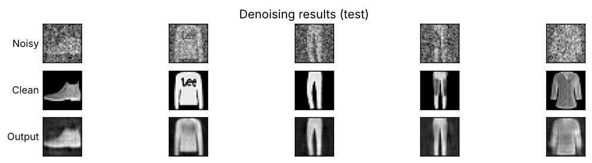
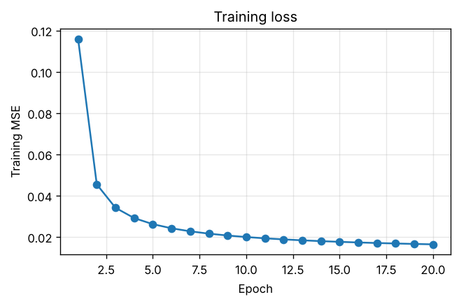
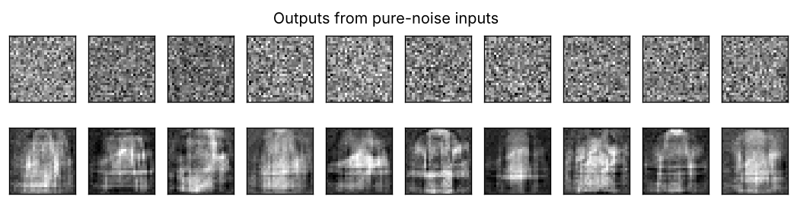

# Denoising Autoencoder — Fashion-MNIST

A fully connected autoencoder that recovers clean 28×28 clothing images from inputs **buried in heavy Gaussian noise**. On the 10,000-image test set it cuts reconstruction error by **9.6×** (**+9.8 dB PSNR**) with a single 300-unit bottleneck and under a minute of CPU training.



---

## Results

Test set: 10,000 unseen images, each corrupted with zero-mean Gaussian noise of σ = 100/255.

| | MSE ↓ | PSNR ↑ |
|---|---|---|
| Noisy input (baseline) | 0.1538 | 8.1 dB |
| **Autoencoder output** | **0.0160** | **17.9 dB** |
| Improvement | **9.6× lower** | **+9.8 dB** |

Train MSE is 0.0149 and test MSE is 0.0160, so the model generalises with only a small train/test gap. Full metrics are in [`results/metrics.json`](results/metrics.json).

<p align="center"></p>

---

## Approach

```
Input 28×28 ─► Flatten (784) ─► Normalization ─► Dense 300 (ReLU) ─► Dense 784 (linear) ─► Reshape 28×28
                                 per-pixel μ/σ        bottleneck
```

| Choice | Setting | Why |
|---|---|---|
| Input normalisation | Keras `Normalization`, adapted on training data | Gives each pixel zero mean and unit variance, which conditions the SGD updates |
| Bottleneck | 1 hidden layer, 300 units | Wide enough to keep garment detail, narrow enough that pixel-independent noise can't be stored |
| Output | 784 linear units, MSE loss | Treats denoising as per-pixel regression |
| Optimiser | SGD + Nesterov momentum 0.9, lr 0.1, `ReduceLROnPlateau` | Fast, stable convergence (loss falls ~7× in 20 epochs) |
| Regularisation | L2 = 1e-5 on all dense kernels | Limits overfitting to the specific noise samples |
| Data | 48k random training images (80%), 10k test | Fixed seed, so every run is fully reproducible |

<!--
OPTIONAL — add your depth-vs-width findings from the project report here, e.g.:
### Depth vs. width
| Hidden layers | Test MSE | Observation |
|---|---|---|
| [300]           | 0.0160 | ... |
| [512, 128, 512] | ...    | ... |
Rerun any architecture with: python src/denoising_autoencoder.py --hidden 512 128 512
-->

### Limitation: an autoencoder is not a generator
Inputs that contain **no garment at all** collapse to blurry "average garment" silhouettes. The latent space is never regularised, so it has no smooth structure to sample from. This is what a **variational autoencoder** fixes.



---

## Run it

```bash
pip install -r requirements.txt
python src/denoising_autoencoder.py                       # reproduces the results above
python src/denoising_autoencoder.py --hidden 512 128 512  # try a deeper architecture
```

Writes `metrics.json` and the result plots to `results/`. For an annotated, step-by-step version, see [`notebooks/walkthrough.ipynb`](notebooks/walkthrough.ipynb).

```
src/denoising_autoencoder.py   data loading, model, training, evaluation and plots (CLI)
notebooks/walkthrough.ipynb    executed walkthrough with inline figures
results/                       metrics.json and generated figures
```

## Next steps
- Add convolutional encoder/decoder layers and compare PSNR against this dense baseline
- Sweep noise level σ and plot output PSNR vs. input PSNR
- Extend to a β-VAE for generation with a structured 2-D latent space

---

<sub>Built as part of a team project for EE4312 at the National University of Singapore. The code has been refactored into a standalone, reproducible script.</sub>

_Skills: deep learning · Keras/TensorFlow · autoencoders · image denoising · experiment design & reproducibility_
